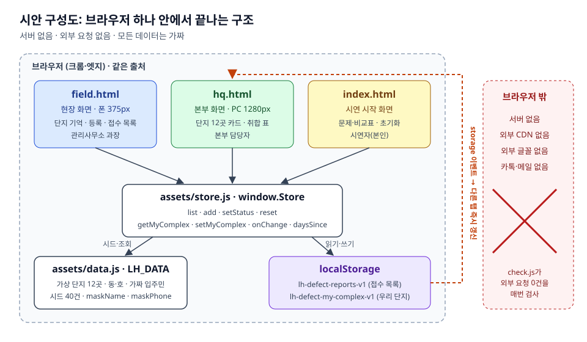

# PRD_TEAM_test

PRD 인터뷰에서 시작해 시연용 시안까지 이어지는 과정을 모아둔 저장소입니다.

지금 들어 있는 것은 **임대주택 생활 하자 접수·취합 도구** 한 건입니다. 단지 관리사무소 과장이 현장에서 폰으로 하자를 1분 안에 등록하면, 본부 화면에 단지 12곳 접수가 한 양식으로 바로 모이는 도구입니다. LH 지역본부 직원 가상 페르소나와 진행한 PRD 인터뷰에서 나왔습니다.

## 구성

| 경로 | 내용 |
|---|---|
| [`prd/lh-defect-intake-prd.md`](prd/lh-defect-intake-prd.md) | PRD. 왜·누가·무엇을·어떻게·성공 5섹션 |
| [`mockup/`](mockup/) | 부서장·전산 부서 설득용 시안. 정적 HTML, 가짜 데이터만 사용 |
| [`mockup/README.md`](mockup/README.md) | 시안 여는 방법, 3분 시연 대본, PRD 기능과 화면 대응표 |
| [`docs/requirements.md`](docs/requirements.md) | 요구사항 명세. 요구사항마다 ID, 사용자 시나리오, 입력·출력, 성공·실패·경계 조건, 접근 권한, 완료 기준 |
| [`docs/traceability.md`](docs/traceability.md) | 요구사항과 테스트를 잇는 추적표. 검사를 돌릴 때마다 자동으로 다시 만들어짐 |
| [`docs/work-plan.md`](docs/work-plan.md) | 작업 계획. 범위 점검, 막는 질문과 가정, 의존 순서별 작업(T1~T6), PRD → 이슈 → 검증 대응표 |
| [`docs/architecture.md`](docs/architecture.md) | 아키텍처 문서. 시안 구조, 데이터 흐름, 데이터 모델, 운영 전환 제안 |
| [`docs/diagrams/`](docs/diagrams/) | 아키텍처 다이어그램(SVG) 4장 |
| [`mockup/ralph/`](mockup/ralph/) | 시안을 만든 랄프 루프의 프롬프트, 할 일 목록, 진행 기록, 검사 스크립트 |



## 바로 해보기

`mockup/index.html`을 크롬이나 엣지로 엽니다. 설치할 것은 없습니다. 화면 사이에 데이터가 반영되지 않으면 로컬 서버로 엽니다.

```bash
cd mockup && python3 -m http.server 8000
```

그다음 `http://localhost:8000/index.html`을 엽니다.

## 검사

```bash
node mockup/ralph/check.js
```

Playwright로 세 화면을 열어 콘솔 에러, 외부 요청, 레이아웃, 개인정보 마스킹, 처음부터 끝까지 시연 시나리오를 확인합니다.

테스트마다 확인하는 요구사항 ID가 함께 출력되고, 끝나면 [`docs/traceability.md`](docs/traceability.md)가 다시 만들어집니다. 새 테스트는 [`mockup/ralph/trace.js`](mockup/ralph/trace.js)에서 요구사항 ID에 연결해야 합니다. 연결되지 않은 테스트나, `충족`인데 테스트가 없는 요구사항이 있으면 검사가 실패합니다.

## 진행 흐름

1. **PRD 인터뷰**: 가상 페르소나와 5단계 인터뷰. 주 사용자가 입주민에서 관리사무소 과장으로, 결과물이 운영 시스템에서 설득용 시안으로 좁혀졌습니다.
2. **시안 제작**: 랄프 루프 6번 반복. 반복마다 할 일 하나를 구현하고 검사를 통과해야 커밋했습니다.
3. **아키텍처 정리**: 시안 구조와 운영 전환 방향을 [`docs/architecture.md`](docs/architecture.md)에 정리했습니다.
4. **요구사항 명세와 추적**: 요구사항 47개에 ID를 붙이고, 테스트 169개를 요구사항에 연결했습니다. 남은 일(범위 결정 2건, 미충족 1건, 수동 검증 3건)은 [추적표](docs/traceability.md)에 있습니다.
5. **작업 계획**: 남은 일을 의존 순서대로 작업 6개로 나눴고, 승인된 범위 5개를 이슈 #2~#6으로 등록했습니다. [`docs/work-plan.md`](docs/work-plan.md)
