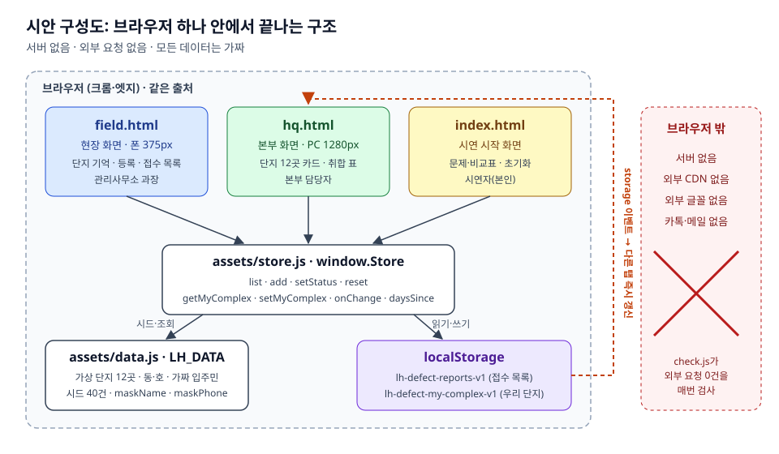
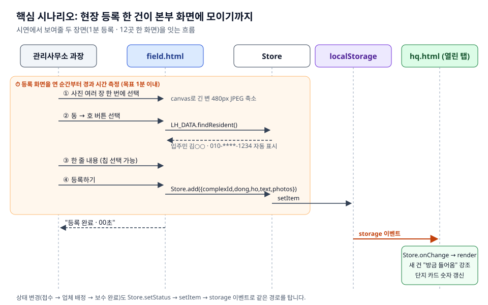
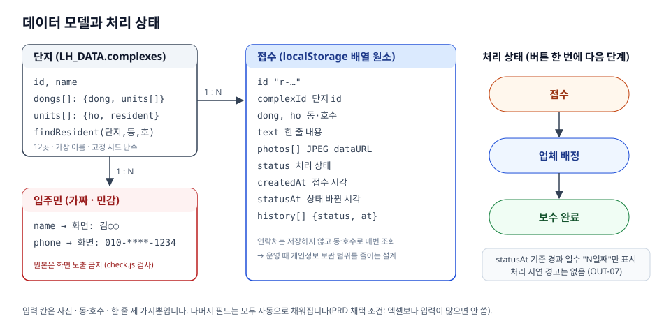
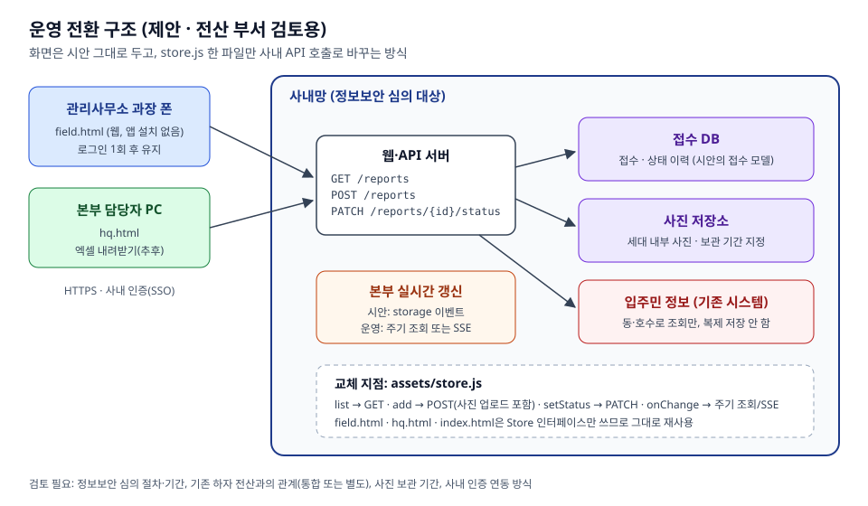

# 아키텍처: 임대주택 생활 하자 접수·취합 시안

이 문서는 `mockup/` 시안이 어떻게 만들어졌는지, 운영으로 넘어갈 때 무엇을 바꾸면 되는지 설명합니다. 읽는 사람은 두 부류입니다.

- **전산 부서**: 운영 전환 검토. [운영 전환 구조](#5-운영-전환-구조-제안)부터 보셔도 됩니다.
- **시안을 고치거나 이어 만드는 사람**: 처음부터 읽어 주세요.

요구사항의 근거는 [PRD](../prd/lh-defect-intake-prd.md)이고, 요구사항 ID별 상세는 [요구사항 명세](requirements.md)에 있습니다.

## 1. 시안이 이뤄야 하는 것

시안은 운영 시스템이 아니라 **부서장과 전산 부서를 설득하는 시연 도구**입니다. 그래서 설계 판단은 모두 3분 시연에서 보여줄 두 장면을 기준으로 했습니다.

1. 관리사무소 과장이 현장에서 폰으로 하자 한 건을 **1분 안에** 등록한다.
2. 그 건이 본부 화면에 **단지 12곳 접수와 같은 양식으로** 바로 모인다.

| PRD 조건 | 아키텍처에서 정한 것 |
|---|---|
| 엑셀보다 귀찮으면 안 씀 | 입력 칸은 사진·동·호수·한 줄 세 가지. 연락처는 동·호수로 자동 조회. 단지는 처음 한 번만 고르면 기억 |
| 외부 클라우드·카톡·메일 사용 불가 | 서버 없이 브라우저 안에서 끝냄. 외부 CDN·글꼴·요청 0건 |
| 시안 단계는 가짜 데이터만 | 고정 시드 난수로 만든 가상 단지 12곳·입주민·접수 40건 |
| 운영은 전산 부서가 맡음 | 화면이 저장 계층(`store.js`)에만 의존하게 해서, 그 한 파일만 바꾸면 되도록 함 |

## 2. 시안 구성



| 파일 | 역할 |
|---|---|
| `mockup/index.html` | 시연 시작 화면. 문제 한 줄, 지금 방식과의 비교, 시연 순서, 데이터 초기화 |
| `mockup/field.html` | 현장 화면(폰 375px). 단지 기억, 새로 등록, 접수 목록과 상태 변경 |
| `mockup/hq.html` | 본부 화면(PC 1280px). 단지 12곳 카드, 한 양식으로 모인 표, 거르기, 사진 크게 보기 |
| `mockup/assets/data.js` | `window.LH_DATA`. 가짜 단지·동·호·입주민, 시드 접수 생성, 마스킹 함수 |
| `mockup/assets/store.js` | `window.Store`. 접수 저장소. 세 화면이 데이터에 닿는 유일한 통로 |
| `mockup/assets/style.css` | 공통 스타일. 본문 16px 이상, 터치 영역 44px 이상 |

의존 방향은 한쪽입니다. 화면 → `Store` → `localStorage`, 화면 → `LH_DATA`. 화면끼리는 서로 직접 부르지 않습니다.

### Store 인터페이스

| 함수 | 하는 일 |
|---|---|
| `list()` | 접수 전체를 최근 순으로 반환. 저장된 것이 없으면 시드 40건을 넣고 반환 |
| `add({complexId, dong, ho, text, photos})` | 새 접수 추가. `id`, `status='접수'`, 시각, 이력은 자동으로 채움 |
| `setStatus(id, status)` | 상태 변경과 이력 추가. 정해진 세 상태 외에는 거부 |
| `reset()` | 시드 상태로 되돌림. "우리 단지" 기억도 지움 |
| `getMyComplex()` / `setMyComplex(id)` | 현장 화면의 단지 기억 |
| `onChange(fn)` | 다른 탭에서 저장소가 바뀌면 `fn` 호출 |
| `daysSince(ts)` | 경과 일수 계산 |

`localStorage`를 쓸 수 없는 환경(사생활 보호 모드 등)에서는 메모리에 대신 저장해서 화면이 깨지지 않습니다. 모든 읽기·쓰기는 `try/catch`로 감쌌습니다.

## 3. 핵심 흐름: 등록에서 본부 반영까지



- **사진**: 원본을 저장하지 않고 canvas로 긴 변 480px JPEG로 줄여 dataURL로 저장합니다. `localStorage` 용량 한도 안에서 시연이 끝까지 돌게 하기 위해서입니다.
- **경과 시간**: 등록 화면을 연 순간부터 재서 완료 화면에 "등록 완료 · 00초"로 보여줍니다. "1분 안에"를 말이 아니라 숫자로 보여주는 장치입니다.
- **실시간 반영**: 같은 브라우저의 다른 탭에서 `localStorage`가 바뀌면 `storage` 이벤트가 옵니다. 본부 화면은 이 이벤트로 새로고침 없이 다시 그리고, 새 건을 "방금 들어옴"으로 강조합니다.
- **제약**: 서버가 없어서 다른 브라우저나 다른 기기끼리는 데이터가 오가지 않습니다. 시연은 한 PC에서 탭 두 개로 합니다.

## 4. 데이터 모델



- **접수**에는 입주민 이름·연락처를 저장하지 않습니다. 화면에 보여줄 때마다 `findResident(단지, 동, 호)`로 조회하고, `maskName`·`maskPhone`을 거쳐 `김○○`, `010-****-1234`로만 표시합니다. 운영에서도 개인정보 보관 범위를 줄이려는 설계입니다.
- **처리 상태**는 `접수 → 업체 배정 → 보수 완료` 한 방향입니다. 현장 화면에서 버튼 한 번으로 다음 단계로 넘어갑니다.
- **멈춤 표시**: 보수 완료 전인데 상태가 바뀐 지 7일 이상이면 현장·본부 화면 모두에 "⚠ 멈춤"을 표시합니다. 기준값 7일은 `hq.html`의 `STALE_DAYS`와 `field.html` 목록 코드에 각각 들어 있어, 바꿀 때는 두 곳을 같이 바꿔야 합니다.
- **시드 데이터**: 고정 시드 난수라 단지·입주민은 매번 같습니다. 접수 날짜만 `Date.now()` 기준 최근 40일로 만듭니다.

## 5. 운영 전환 구조 (제안)



화면 세 개는 `Store` 인터페이스만 쓰므로, 운영 전환 때는 `store.js`를 사내 API 호출로 바꾸는 것이 출발점입니다.

| 시안 (`store.js`) | 운영 (제안) |
|---|---|
| `list()` → localStorage 읽기 | `GET /reports` (단지·상태 거르기는 서버에서) |
| `add()` → localStorage 쓰기 | `POST /reports` + 사진 업로드 |
| `setStatus()` | `PATCH /reports/{id}/status` |
| `onChange()` → storage 이벤트 | 주기 조회 또는 SSE |
| `getMyComplex()` → localStorage | 사내 인증 계정에 묶인 소속 단지 |
| `LH_DATA.findResident()` → 가짜 데이터 | 기존 입주민 시스템 조회 (복제 저장하지 않음) |

바꾸면서 동기 함수가 비동기(Promise)로 바뀌므로, 화면 코드에서 `Store` 호출부에 `await`를 붙이는 수정이 함께 필요합니다.

### 전산 부서와 정해야 할 것

- 정보보안 심의 절차와 기간. 시범 일정에 가장 큰 변수입니다.
- 기존 하자 전산(준공 직후 하자담보 위주)과의 관계: 통합할지, 생활 하자용으로 따로 둘지. 기존 전산이 현장에서 왜 안 쓰였는지 먼저 확인이 필요합니다.
- 세대 내부 사진의 보관 기간과 접근 권한
- 사내 인증(SSO) 연동 방식. "매번 로그인하면 안 쓴다"는 PRD 조건을 지킬 수 있어야 합니다.

## 6. 품질 확인 방식

시안은 [랄프 루프](../mockup/ralph/PROMPT.md)로 만들었습니다. 매 반복마다 새 에이전트가 같은 프롬프트, [할 일 목록](../mockup/ralph/fix_plan.md), [진행 기록](../mockup/ralph/progress.md)만 읽고 한 항목씩 구현했고, 검사를 통과해야만 커밋했습니다.

`mockup/ralph/check.js`가 모든 검사를 맡습니다. Node 내장 http로 `mockup/`을 띄우고 Playwright로 확인합니다.

- 세 화면 모두 콘솔 에러 0건, 외부 요청 0건
- 375px·1280px에서 가로 스크롤·넘침·잘림 없음, 글씨 16px 이상
- 처음부터 끝까지 시연 시나리오: 초기화 → 현장 등록 → 본부 반영 → 현장 상태 변경 → 본부 반영
- 화면 어디에도 마스킹되지 않은 연락처가 없음

```bash
node mockup/ralph/check.js
```

검사 결과에는 테스트마다 요구사항 ID가 함께 찍히고, [요구사항 추적표](traceability.md)가 다시 만들어집니다. 연결 규칙은 `mockup/ralph/trace.js`에 있습니다.
